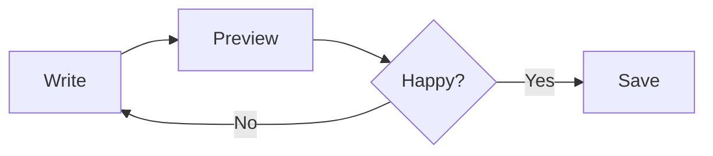

# Welcome to Inkwell

A **seamless** Markdown editor — move your caret onto this line and the `#`
marker reappears so you can edit it.

## Try it

- *Italic*, **bold**, ~~strikethrough~~ and `inline code`
- A [link](https://typora.io) styled inline
- Headings resize as you type
- <u>Underline</u>, ==highlight==, H~2~O, x^2^ (and a hidden comment <!-- like this -->)
- Emoji shortcodes like :tada: :rocket: :coffee: render inline

## Lists

- Bullet at depth one
  - Nested item (hollow ◦ bullet)
    - Deeper still (▪ bullet)
- A long bullet that wraps onto a second line so you can see the hanging indent line up under the text rather than under the bullet

1. Ordered item one
2. Ordered item two
3. Ordered item three

## Tasks

- [x] Hide markdown markers on idle lines
- [ ] Click this box to toggle it
- [ ] Render tables as widgets

> Markers hide on idle lines and reveal on the line you're editing.
>
> > Quotes can nest, too.

---

## Links

Ctrl/⌘-click to follow: an [inline link](https://github.com), a
[reference link][repo], an autolink <https://typora.io>, a bare URL
https://example.com, and an internal jump to the [Tasks](#tasks) heading.

[repo]: https://github.com/kainpl/inkwell

## Images

An image renders in place when its line is idle; click the line to reveal the
`` source. Relative paths like `` resolve
from the document's folder once the file is saved, and you can paste or drag &
drop an image to copy it into an `assets/` folder automatically. Hover a rendered
image to get a resize handle, click it to zoom, or use Format → Toggle Image
Markdown/HTML to switch syntax (HTML keeps a `width`).

## Code

Fenced blocks get a shaded panel, a language badge, and a copy button:

```js
function greet(name) {
  return `Hello, ${name}!`
}
```

## Math

Inline math like $E = mc^2$ renders with KaTeX, and block math too:

$$
\int_0^\infty e^{-x}\,dx = 1
$$

## Diagrams

A `mermaid` code block renders as a diagram when the block is idle:



## Alerts

> [!NOTE]
> Highlight information users should take into account.

> [!WARNING]
> Critical content demanding attention.

## Footnotes

Here is a statement with a footnote[^note]. Hover the marker to read it.

[^note]: Footnotes render as superscripts with the text as a tooltip.

## Tables

| Feature   | Status |
| :-------- | :----: |
| Rendering | done   |
| Editing   | done   |

Put the caret in a cell, then use **Format → Table** to add/delete rows and
columns or change alignment. Click outside the table to see it rendered.

## Table of Contents

[toc]

### Next

Open a folder (`Ctrl/⌘ Shift O`) to browse files, or just start writing.
