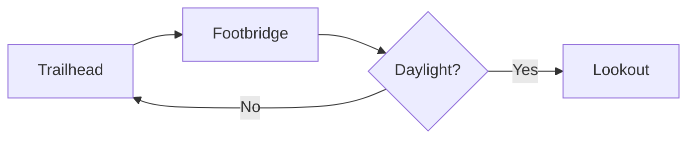

# Welcome to Inkwell

Click into a line to edit its Markdown. Click another line to see the result. **Source** shows the whole document as Markdown. Try checking a task, editing a table cell, or changing a label in the diagram below.

## Text and lists

*Italic*, **bold**, ~~strikethrough~~ and `inline code`. Compare <u>underline</u> with ==highlight==, write H~2~O and x^2^, or type an emoji shortcode like :coffee:. <!-- This comment appears when you edit the line. -->

- Prepare a field notebook
  - Pick a route
    - Mark a place to stop
- Pack a pencil

1. Write down an observation.
2. Add it to the table.

- [x] Open the notebook
- [ ] Click this box to mark the walk complete

> Take only what you need for the walk.
>
> > A spare pencil counts.

---

## Links and tables {#observations}

Ctrl-click (⌘-click on macOS) to jump to the [first observation](#stop-01) or this [section heading](#observations). Try an [inline link](https://commonmark.org), a [reference link][repo], or an autolink <https://example.com>.

[repo]: https://github.com/kainpl/inkwell

| Stop | Observation | Distance |
| :--- | :---------: | -------: |
| <a id="stop-01"></a>**01** | Footbridge | 2 km |
| **02** | Lookout | 5 km |

Hover over a cell to use the table toolbar. Add a row or change the column alignment, then switch to **Source** to see the edit.

## Images


Hover over the image and drag its lower-right handle. The alignment buttons move it left, center or right.

## Code, math and diagrams

```js
function distance(points) {
  return points.reduce((sum, km) => sum + km, 0)
}
```

If the legs of the walk are $a$ and $b$, the total distance is

$$
d = a + b = 2 + 3 = 5\,\mathrm{km}
$$



## Notes and definitions

> [!NOTE]
> The footbridge is a good place to stop for coffee. :coffee:

> [!WARNING]
> The path beyond the lookout is steep after rain.

The distances are approximate[^map].

[^map]: Measured along the path, including the bends.

Waypoint
: A marked point along the route.

<details>
<summary>Open the field note</summary>
<p>The return trip follows the same trail.</p>
</details>

## Contents

[toc]
