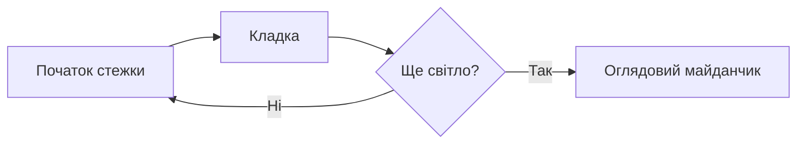

# Вітаємо в Inkwell

Клацніть рядок, щоб редагувати його розмітку. Переведіть курсор на інший рядок, щоб побачити результат. Кнопка **Вихідний код** показує весь документ у Markdown. Спробуйте позначити завдання, змінити клітинку таблиці чи підпис у діаграмі нижче.

## Текст і списки

*Курсив*, **жирний текст**, ~~закреслення~~ та `вбудований код`. Порівняйте <u>підкреслення</u> з ==виділенням==, запишіть H~2~O і x^2^ або введіть код емодзі :coffee:. <!-- Цей коментар видно під час редагування рядка. -->

- Підготувати польовий нотатник
  - Обрати маршрут
    - Позначити місце для зупинки
- Запакувати олівець

1. Запишіть спостереження.
2. Додайте його до таблиці.

- [x] Відкрити нотатник
- [ ] Клацнути тут після завершення прогулянки

> Бери в дорогу тільки потрібне.
>
> > Запасний олівець теж знадобиться.

---

## Посилання й таблиці {#observations}

Затисніть Ctrl (⌘ на macOS) і клацніть, щоб перейти до [першого спостереження](#stop-01) або [заголовка цього розділу](#observations). Спробуйте [звичайне посилання](https://commonmark.org), [посилання за міткою][repo] й автоматичне посилання <https://example.com>.

[repo]: https://github.com/kainpl/inkwell

| Зупинка | Спостереження | Відстань |
| :------ | :-----------: | -------: |
| <a id="stop-01"></a>**01** | Кладка через струмок | 2 км |
| **02** | Оглядовий майданчик | 5 км |

Наведіть вказівник на клітинку, щоб відкрити панель таблиці. Додайте рядок або змініть вирівнювання стовпця, потім натисніть **Вихідний код**, щоб побачити зміни.

## Зображення


Наведіть вказівник на зображення й потягніть за його правий нижній кут. Кнопками вирівнювання можна розташувати зображення ліворуч, по центру або праворуч.

## Код, формули й діаграми

```js
function distance(points) {
  return points.reduce((sum, km) => sum + km, 0)
}
```

Якщо довжини відрізків шляху дорівнюють $a$ і $b$, то загальна відстань становить

$$
d = a + b = 2 + 3 = 5\,\text{км}
$$



## Примітки й визначення

> [!NOTE]
> Біля кладки зручно зупинитися на каву. :coffee:

> [!WARNING]
> Після дощу стежка за оглядовим майданчиком стає слизькою.

Відстані приблизні[^map].

[^map]: Виміряно вздовж стежки з урахуванням поворотів.

Орієнтир
: Помітна точка на маршруті.

<details>
<summary>Відкрити польову нотатку</summary>
<p>Назад повертаємося тією самою стежкою.</p>
</details>

## Зміст

[toc]
